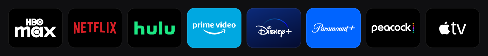
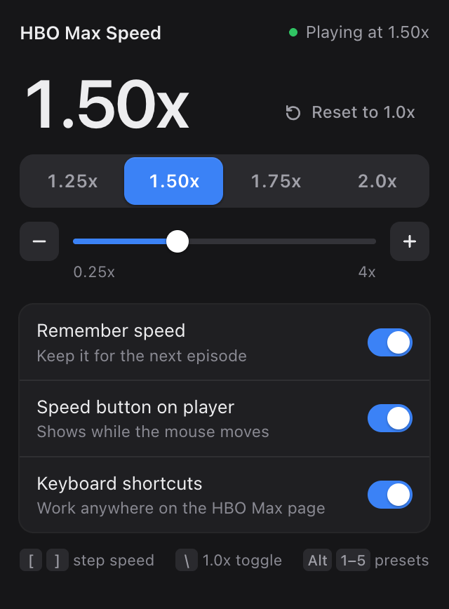
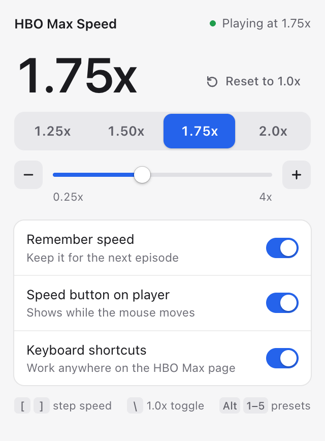

<div align="center">


# Streaming Speed Control

**Watch HBO Max, Netflix, Hulu, Prime Video, Disney+, Paramount+, Peacock and Apple TV at 1.25x, 1.5x, 1.75x, 2x, or any speed from 0.25x to 4x.**<br />
A free, open-source browser extension that adds the speed control your streaming player is missing.

[](LICENSE)


[Install](#install) · [Supported services](#supported-services) · [How to use](#how-to-use) · [Keyboard shortcuts](#keyboard-shortcuts) · [FAQ](#faq) · [Contributing](#contributing)


</div>

## Why

YouTube and most podcast apps let you pick any playback speed. Streaming services mostly don't: some have no speed control at all, and the ones that do stop at 1.5x. If you like rewatching shows faster, getting through slow episodes, or slowing down a scene to catch a line, you're stuck with whatever the player gives you.

This extension adds one speed control that works the same way on all of them. Click a speed and it sticks, even when the player resets it and into the next episode.

## Supported services



| Service | Sites |
|---|---|
| HBO Max | `hbomax.com`, `max.com` |
| Netflix | `netflix.com` |
| Hulu | `hulu.com` |
| Prime Video | `primevideo.com`, and the Prime Video section (`/gp/video`) of Amazon's store sites: `amazon.com`, `.co.uk`, `.de`, `.co.jp`, `.ca`, `.com.au`, `.in`, `.fr`, `.it`, `.es`, `.com.mx`, `.com.br`, `.nl` |
| Disney+ | `disneyplus.com` |
| Paramount+ | `paramountplus.com` |
| Peacock | `peacocktv.com` |
| Apple TV | `tv.apple.com` |

Want another service? [Open an issue](https://github.com/yuslama/streaming-speed-control/issues) with its website.

## Features

- **One-click favorites:** `1.25x`, `1.50x`, `1.75x` and `2.0x`, right in the popup.
- **Any speed from 0.25x to 4x:** a slider plus `−` / `+` buttons that move in 0.05x steps.
- **Speed button on the player:** a small button in the top-right corner of the video, including in fullscreen. It hides when you stop moving the mouse.
- **Keyboard shortcuts** for changing speed without leaving the video.
- **Remembers your speed** across episodes, page reloads and services (optional).
- **Natural-sounding audio:** voices keep their normal pitch at higher speeds.
- **Holds the speed:** if the player resets the speed (for example when the next episode starts), the extension sets it back.
- **Speed on the toolbar icon:** a small badge shows the current speed whenever it isn't 1.0x.
- **Light and dark popup** that follows your system setting.
- **Private:** no accounts, no analytics, no network requests. Settings stay in your browser.

## Screenshots

<table>
  <tr>
    <td align="center" width="50%">
      <br />
      <sub>Popup, dark mode</sub>
    </td>
    <td align="center" width="50%">
      <br />
      <sub>Popup, light mode</sub>
    </td>
  </tr>
  <tr>
    <td align="center" colspan="2">
      <br />
      <sub>Speed menu on the player</sub>
    </td>
  </tr>
</table>

## Install

The extension isn't on the Chrome Web Store yet, so you install it from this repository. It takes about a minute.

1. **Download the extension:** grab the `streaming-speed-control-v….zip` file from the [latest release](https://github.com/yuslama/streaming-speed-control/releases/latest) and unzip it.
   Or clone the repository:
   ```bash
   git clone https://github.com/yuslama/streaming-speed-control.git
   ```
2. **Open the extensions page:** go to `chrome://extensions` (Edge: `edge://extensions`, Brave: `brave://extensions`).
3. **Turn on Developer mode** with the switch in the top-right corner.
4. **Click "Load unpacked"** and select the unzipped folder (the one that contains `manifest.json`).
5. **Pin it:** click the puzzle-piece icon in the toolbar and pin **Streaming Speed Control** so it's always one click away.

Open one of the [supported services](#supported-services), start a show, and pick a speed.

**Updating:** download the new release ZIP (or `git pull`), replace the old folder, then click the reload icon on the extension's card in `chrome://extensions`. Reload any open streaming tabs afterwards.

**Coming from HBO Max Playback Speed 1.0?** This is the same extension, renamed. Remove the old one in `chrome://extensions` and load the new folder.

### Supported browsers

Desktop Google Chrome and Chromium-based browsers with Manifest V3 support, including de-Googled builds such as Ardia. Microsoft Edge, Brave, Arc, Opera and Vivaldi should work the same way. Firefox and Safari aren't supported yet.

**Ardia on Mac:** Ardia opens streaming sites in its WebKit (Safari) engine by default so protected video can play, and extensions can't run there. To use the extension, remove the **Streaming sites** row under **Settings › Advanced › Web engine** so those sites open in Chromium. Protected video may not play in Ardia's Chromium engine.

## How to use

**From the popup.** Click the toolbar icon while a show is playing. Pick a favorite speed, drag the slider, or use `−` / `+` for fine steps. **Reset to 1.0x** puts it back to normal.

The status line at the top tells you whether the speed reached the video:

| Status | Meaning |
|---|---|
| 🟢 Playing on Netflix | The video on that service is playing at the speed shown. |
| 🟡 Start a video to apply | A streaming tab is open, but no video is playing yet. The speed applies as soon as one starts. |
| ⚪ Open a streaming site | No supported tab was found. Your choice is saved for next time. |

**On the player.** Move your mouse over the video and click the speed button in the top-right corner to open the speed menu. Shift-click `−` / `+` for 0.05x steps. Turn the button off in the popup with **Speed button on player** if you prefer a clean screen.


<sub>When you change speed with the keyboard, the new speed flashes at the top of the player.</sub>

## Keyboard shortcuts

Shortcuts work on any supported service, except while you're typing in a text field. Turn them off in the popup with **Keyboard shortcuts**.

| Keys | Action |
|---|---|
| <kbd>]</kbd> or <kbd>&gt;</kbd> | Faster by 0.25x |
| <kbd>[</kbd> or <kbd>&lt;</kbd> | Slower by 0.25x |
| <kbd>&#92;</kbd> | Switch between 1.0x and your last speed |
| <kbd>Alt</kbd> + <kbd>1</kbd> | 1.0x |
| <kbd>Alt</kbd> + <kbd>2</kbd> | 1.25x |
| <kbd>Alt</kbd> + <kbd>3</kbd> | 1.5x |
| <kbd>Alt</kbd> + <kbd>4</kbd> | 1.75x |
| <kbd>Alt</kbd> + <kbd>5</kbd> | 2.0x |

On a Mac, <kbd>Alt</kbd> is the <kbd>Option</kbd> key.

## FAQ

<details>
<summary><b>Is this allowed? Will it get my account banned?</b></summary>

The extension only changes the playback rate of the video element in your own browser, the same thing the browser's built-in video controls do on other sites. It doesn't download, record or modify any content, and it doesn't touch your account. That said, it isn't affiliated with or endorsed by any of the streaming services, so use it at your own discretion.
</details>

<details>
<summary><b>The popup says "Open a streaming site" but one is open.</b></summary>

Reload the streaming tab once after installing or updating the extension, then open the popup again. Hover over the status line to see which services are supported and which tabs the extension found.
</details>

<details>
<summary><b>The speed went back to 1x.</b></summary>

Make sure **Remember speed** is on in the popup. If the player still resets it, press <kbd>]</kbd> once or click your speed again, and please [open an issue](https://github.com/yuslama/streaming-speed-control/issues) with the service, the show and what you did, so it can be fixed.
</details>

<details>
<summary><b>Does it work in fullscreen?</b></summary>

Yes. The speed button moves into the fullscreen player, and the keyboard shortcuts keep working.
</details>

<details>
<summary><b>Why does Chrome say it can "read and change your data" on Amazon?</b></summary>

Prime Video plays inside Amazon's store sites at `amazon.com/gp/video` (and the same path on other Amazon country sites). Chrome's install warning lists the whole site, but the extension's code only runs on the `/gp/video` pages, never on the rest of the store.
</details>

<details>
<summary><b>Does it collect any data?</b></summary>

No. There are no analytics and no network requests. Your settings (speed and the three switches) are saved with the browser's own extension storage.
</details>

<details>
<summary><b>Which permissions does it ask for, and why?</b></summary>

- **Access to the supported streaming sites:** to find the video and set its speed. It doesn't run on any other site.
- **storage:** to remember your speed and settings.
- **tabs, activeTab, scripting:** so the popup can find your streaming tab and connect to it when you open the popup.
</details>

## Privacy

This extension runs only on the [supported streaming sites](#supported-services). It doesn't collect, send or sell any data, and it makes no network requests of its own.

## Contributing

Bug reports, ideas and pull requests are welcome. Please [open an issue](https://github.com/yuslama/streaming-speed-control/issues) first for anything bigger than a small fix.

The extension is plain HTML, CSS and JavaScript with no build step and no runtime dependencies. You need Node.js 18 or newer for the dev scripts.

```bash
npm test             # unit tests and manifest checks
npm run check        # syntax-check every script
npm run icons        # regenerate the icons from scripts/generate-icons.mjs
npm run screenshots  # regenerate the README images (needs Google Chrome)
npm run package      # build the release ZIP into dist/
```

**Adding a service:** add it to `SERVICES` in `src/shared/speed-utils.js`, add the matching `https://*.<domain>/*` patterns to both `host_permissions` and `content_scripts.matches` in `manifest.json`, and run `npm test`. The manifest test checks that the two lists agree.

### Project layout

```
manifest.json                Extension manifest (Manifest V3)
src/popup/                   Toolbar popup
src/content/                 Runs on streaming sites: finds the video, sets the speed, draws the player button
src/background/              Service worker: toolbar badge and tab tracking
src/shared/speed-utils.js    Supported services, speed limits, presets and formatting shared by all parts
scripts/                     Icon generator and screenshot tooling
tests/                       Node test runner tests
```

To try your changes, load the folder with **Load unpacked** as described in [Install](#install), and click the reload icon on the extension's card after each change.

## License

[MIT](LICENSE)

---

<sub>Not affiliated with, endorsed by, or sponsored by any of the streaming services named here. HBO Max, Netflix, Hulu, Prime Video, Disney+, Paramount+, Peacock and Apple TV are trademarks of their respective owners and are used here only to describe what the extension works with. The film still in the player screenshots is from <i>Dune: Part Two</i> (© 2024 Legendary Pictures / Warner Bros.) and is shown for illustration only.</sub>
